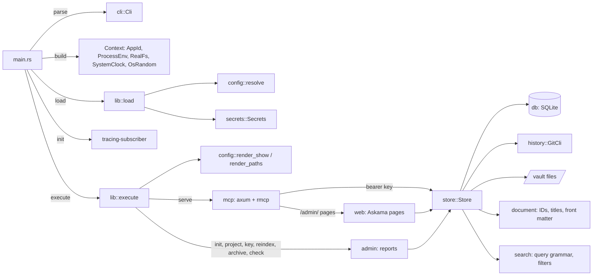
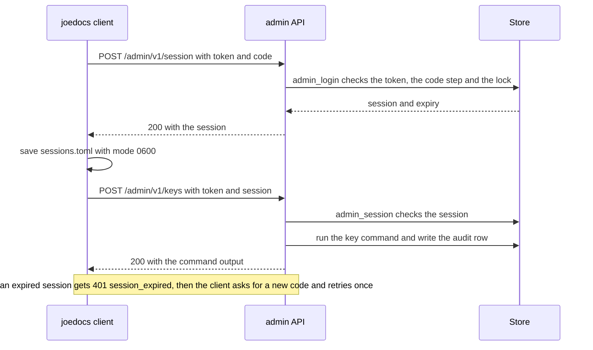
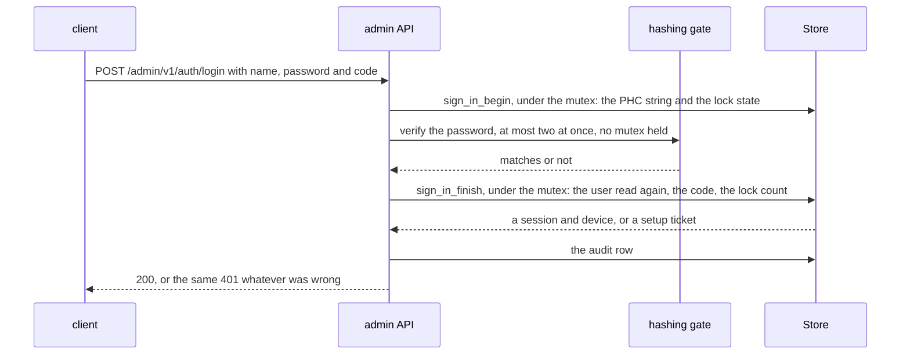
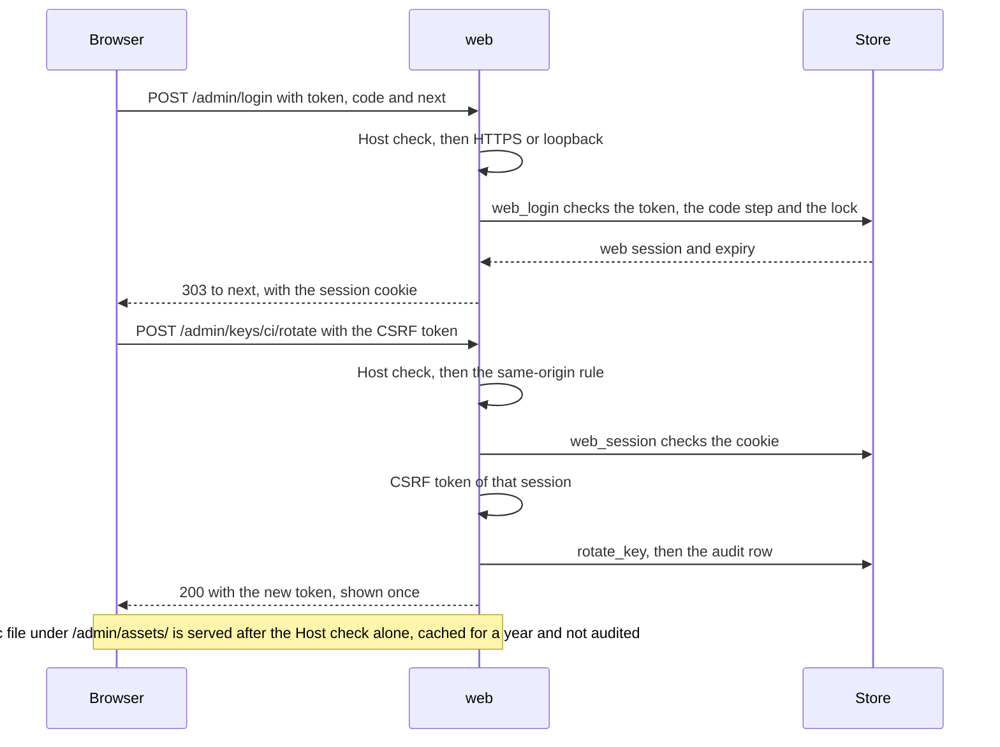
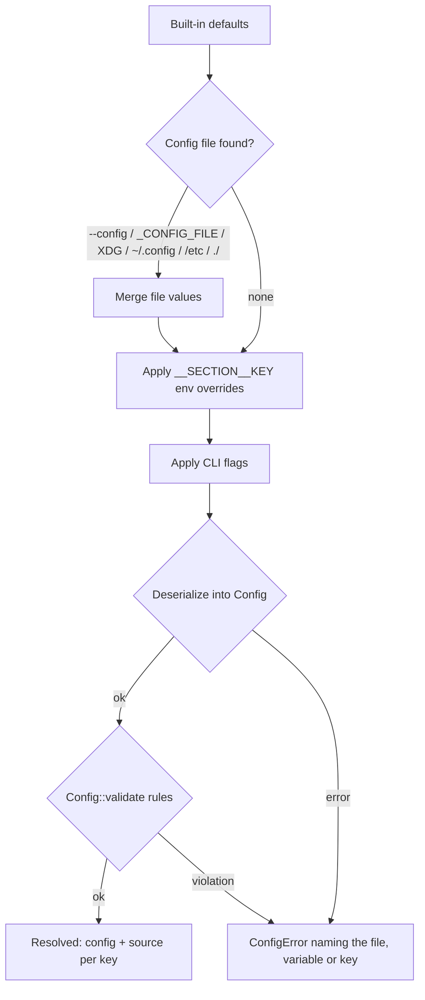

# Architecture

## Overview

`joedocs` is a command-line application split into a thin binary (`src/main.rs`) and a library (`src/lib.rs`) that holds all logic. The library never reads the real process environment, clock or random source directly, nor runs `systemctl`: they are injected through the `Env`, `FileSystem`, `Clock`, `RandomSource` and `ServiceManager` traits. The document store works on configured directories (temporary ones in tests) and keeps its history behind the `History` trait, implemented with the `git` command line. The design and phases are in [plan.md](plan.md).

## Modules

| Module | Responsibility |
| --- | --- |
| `main.rs` | Parse args, build the real `Context`, load config, start logging, run, map errors to exit codes. |
| `lib.rs` | `load`, `execute`, `open_store` and `catch_up` (the rebuild `serve` runs on start, followed by rewriting each project's `INDEX.md`), the `Error` type, exit codes. |
| `cli` | `clap` definitions and conversion of flags to config values. |
| `config` | Schema and defaults (`mod.rs`), resolution (`resolve.rs`), rule checks (`validate.rs`), diagnostics (`show.rs`). |
| `env` | `Env` trait, `ProcessEnv` (process environment over `.env`), `MapEnv` (tests). |
| `fs` | `FileSystem` trait, `RealFs`, `MemFs` (tests). |
| `secrets` | Secrets from the environment, held in `SecretString`. |
| `app_id` | Application name and the environment prefix derived from it. |
| `clock` | `Clock` trait, `SystemClock`, `FixedClock` (tests), RFC 3339 formatting. |
| `document` | Pure domain rules: slugs, project keys, `DocumentId`, titles and file stems, front matter classes, parsing, serialising and change rules. |
| `store` | Document use cases (create, get, update, edit, append, rename, move, change front matter, restore a revision, archive and unarchive, list, search, history, diff), projects and API keys, the write lock, the integrity guard, the undo journal for vault files, the file → history → database ordering, each project's generated `INDEX.md` (`index_file.rs`), `reindex` and `check`, the backup snapshot (taken under the write lock), admin tokens with their TOTP logins, lockout and sessions, and users (`users.rs`, `sign_in.rs`): user administration, sign-in in phases, TOTP setup, device credentials, user sessions and the per-name sign-in lock. The store never sees a password: callers pass in a PHC string or the verifier's answer. |
| `db` | SQLite connection setup, embedded migrations, and queries as free functions over a connection, including the search index (`doc_fields`, `doc_fts`). |
| `history` | `History` trait and `GitCli`, with the git directory outside the vault: commit, show, log and diff. |
| `auth` | API key generation, parsing, hashing and verification; `Permission` and `Grant`; `RandomSource`; the prefixes of every credential (`jd_`, `jda_`, `jds_`, `jdw_`, `jdd_`, `jdu_`, `jdv_`, `jdt_`). |
| `password` | The rules for a new password (length after NFC, the user's name, a compiled-in list of common passwords), Argon2id hashing as PHC strings, the dummy hash for unknown names, one-time initial passwords, and `Gate`: hashing on blocking threads, at most two at once, never under the store lock. |
| `systemd` | `joedocs systemd install|remove`: renders a user or sandboxed system unit that pins the effective configuration, and runs `systemctl` through `ServiceManager`. |
| `admin` | Text reports for `init`, `project`, `key`, `reindex`, `archive` and `check`. |
| `mcp` | `joedocs serve`: the axum app (`/mcp` behind bearer authentication, `/health`), rmcp's Streamable HTTP service with `Host`/`Origin` checks, the nineteen tools with JSON schemas, grant checks, audit logging, and error mapping. |
| `mcp::admin_api` | The `/admin/v1/` API, merged into the router only when `admin.enabled`: `Host`/`Origin` checks, device-credential and admin-token session authentication, TOTP login, the user routes (`user_api.rs`: sign-in and setup in three phases around the hashing gate, `me`, devices, users), the `Deprecation` header on admin-token replies, one audit row per call, and routes that run the same `admin` command functions and return their text. `status`, `documents/{id}` and `backup` return data and the archive. The routes added in 0.4.2 (`documents`, `search`, `documents/{id}/history`, `documents/{id}/diff`, `audit`) return JSON built by `browse`, in the shapes of the matching MCP tool results, for client mode. One handler reads every request itself (a 64 KiB body limit), so nothing is rejected before it is checked and audited. A remote backup (`backup_download`, shared with the web interface) stages its snapshot under the store mutex and write lock, then compresses without them, so other calls carry on. |
| `web` | The admin web interface under `/admin/`, merged into the router only when `admin.enabled` and `admin.web_ui`: routing and the audit tool of each page (`mod.rs`, whose documentation lists them), the session cookie, CSRF token and same-origin rule (`session.rs`), static files under content-hashed paths (`assets.rs`, with htmx and Pele vendored in `assets/vendor/`), Obsidian-style Markdown to safe HTML (`markdown.rs`) and PlantUML text encoding (`plantuml.rs`), and one module per workspace in `pages/` with its Askama template in `templates/`. Pages call the store, `browse` and `admin` functions in-process, never the JSON API. |
| `browse` | `joedocs list`, `search`, `history`, `diff` and `audit`: from arguments to store requests, the JSON reply (the MCP tool result shapes, built from the same output types), and the tables printed from it. Local runs and client mode both render the reply, so they print the same; table cells escape control characters. |
| `client` | `joedocs` as a client of a server's admin API (`client.server`, `--server`): reqwest with rustls (ring) and the OS root store, the session file and the device file (`client_user.rs`: `auth login` with TOTP setup, renewal with a device credential), the `Prompt` trait for codes and passwords, and the re-login retry. |
| `status` | `joedocs status`: `StatusReport` (shared with the admin API), the `/health` probe, systemd unit state through `ServiceManager`, directory sizes. |
| `agents` | `joedocs agents`: renders `src/agents.md` with this installation's facts. |
| `backup` | `joedocs backup`: the archive format (manifest, `state/`, `content/`), writing it from a store snapshot, and the restore that refuses unsafe entries. |
| `totp` | Pure TOTP (RFC 6238) and HOTP (RFC 4226), base32 (RFC 4648) and `otpauth://` URIs. |
| `search` | Pure: the forgiving query grammar and its FTS5 translation (`query.rs`), and front matter filters, their SQL translation and value flattening (`filter.rs`). |

## Request path

An MCP request first passes the bearer-key middleware, which looks the token up (SHA-256 of the secret) and attaches the key's name and grants to the request. rmcp then checks `Host` and `Origin` and dispatches the tool. Each tool checks the grant for the target project, runs the store operation under the store mutex on a blocking thread, writes an audit entry for changes, and returns structured JSON or a structured error.

## Admin request path

The admin API serves the admin commands to other machines. It is off unless `admin.enabled` is set, and it is a separate router, never MCP tools, so a document API key never reaches it. A user signs in with a name, a password and a TOTP code (`auth/login`) and gets a device credential (`jdd_...`) and a session (`jdu_...`); later sessions need the device credential and a code. A deprecated admin token (`jda_...`, created only on the server) plus a code opens a session (`jds_...`). Sessions last `admin.session_hours`, and every later call sends the credential and the session. The server checks the session before it runs anything, so a client that logs in again after an expired session can retry without repeating a change.

A password sign-in runs in three phases, so the store mutex is never held while a password is hashed (about 12 ms and 19 MiB each). Holding it would make every MCP request wait behind sign-in attempts:

## Web request path

The web interface is the admin API's operations as server-rendered pages. It is off unless both `admin.enabled` and `admin.web_ui` are set. A user's name, password and TOTP code (or, deprecated, an admin token and a code) open a web session (`jdv_...` or `jdw_...`) that the API does not accept, held in an `HttpOnly`, `SameSite=Strict` cookie; neither a password nor a token is stored by the browser. The sign-in, TOTP setup, password change, user creation and reset posts hash a password, so they run in the same three phases as the API's. Every request is checked and audited before anything else runs, and the handler runs on a blocking thread under the store mutex, as an MCP tool does. htmx only swaps parts of a page in place: every page and form also works as a plain link or form post.

Documents are rendered to HTML on the server (`web::markdown`), so the browser never parses Markdown. Raw HTML in a document becomes text, links keep only safe schemes, and every element the renderer writes comes from escaped parts. Mermaid blocks are placeholders that the bundled Pele draws in the page; PlantUML blocks are images from the configured PlantUML server. The Content-Security-Policy allows no inline script, so `app.js` and htmx are the only scripts.

## Write path

Every document change takes the write lock (a file lock in the state directory), checks the index's recorded history head against git `HEAD`, and then runs inside one database transaction: validate, check the file on disk still has the hash the index recorded, write the vault file (undoably), commit to git, record the revision and new head, commit the transaction. Any failure before the git commit undoes the file writes, removes the directories they created, and rolls the transaction back, so a retry starts from the same vault. The same transaction replaces the document's search entries: every front matter value in `doc_fields`, and the title, aliases and body in the FTS5 table `doc_fts`. See [plan.md section 11](plan.md#11-write-path-example-update_document).

A multi-file document's main file keeps the `documents` row; each other file has a `document_files` row (path in the folder, the revision at which it last changed, its hash) and its own search entries (`doc_fields` rows carrying its `file_id`, and a `doc_fts` row with rowid `-id`). Every change to any of its files raises the document's revision, takes the same lock and transaction, checks every file of the document against its recorded hash, and records the files it changed in `revision_files` and in `JoeDocs-File` commit trailers. Adding a file (`Store::create_file`, in `store/files.rs`) leaves the main file untouched.

Every change other than create and archive goes through one path (`Store::revise`): it reads the verified file, lets the operation change a draft of the title, type, status, other front matter and body, then writes the result, moving the file if the title or type changed. Rename, move, update, edit, append, front matter changes and restore differ only in how they change the draft.

After the database commit, still holding the write lock, the change rewrites its project's `INDEX.md` (when `documents.index_file` is on), and so do `project add`, `reindex` and the start of `serve`. The file is generated from the database, written to a temporary file and renamed into place, and skipped when its content would not change. A failure only logs a warning, since the document change is already committed. A change to a multi-file document also rewrites the `INDEX.md` in its folder the same way. `INDEX.md` never enters the history: the store adds `/*/INDEX.md` and `/*/*/*/INDEX.md` to the history's `info/exclude`.

## Search

`search_documents` parses `query` into a quoted FTS5 expression (so no input is a syntax error) and `filters` into `EXISTS` conditions over `doc_fields`, then runs one SQL query: driven by the FTS5 match when there is text (ranked by `bm25`, title ten times body, with a snippet), otherwise by the documents table, newest first. `"*"` searches every project the key holds a grant on. Each file of a multi-file document is its own search entry: its `doc_fts` row has rowid `-document_files.id` (a main file's is `project_id * 2^32 + seq`), and its `doc_fields` rows carry its `file_id`, so filters test the front matter of the entry that matched and main files and sub-files rank in one query.

## Rebuilding the index

The documents, revisions and search tables are an index of the history: every revision is a commit whose trailers name the document, revision, action and client, and the latest content of each document carries the rest in front matter. A multi-file document's commits also name each file they change in `JoeDocs-File` trailers; the main file is the one at `<project>/<type>/<name>/<name>.md`, so a rebuild tells it from the other files by path, and a commit that changes a path no trailer names cannot be replayed. Rebuilt files are inserted in the order they were created, so they get the same row IDs. `joedocs reindex` replays `git log` into fresh tables in one transaction, recreates projects missing from the database from front matter, and reports vault files that differ from the history. `serve` runs it on start when the index records another history commit than `HEAD` (a write interrupted between the git commit and the database commit) or another index format (a database from an older build), so writes are never left refused. Then it rewrites every project's `INDEX.md`, so a file deleted or edited by hand is restored before the server listens.

## Configuration resolution

## Key decisions

- **In-house config resolution.** Precedence, override parsing and provenance are explicit and testable without mutating the process environment, which is `unsafe` in Rust 2024.
- **Every config key has a default.** Defaults define each key's type, which is how environment override strings are parsed.
- **Secrets are separate from config.** They never appear in `config.toml`, overrides or `config show` output.
- **Exit codes follow `sysexits.h`.** `1` when `check` finds problems, `65` for requests the user can fix, `69` when the server cannot listen, `70` for store faults, `74` for output errors, `78` for configuration errors.
- **Git through its command line.** No new crates, and administrators can inspect the history with normal git. The user's git configuration is ignored so hooks and signing cannot interfere.
- **A server-rendered admin web interface.** Askama templates compiled into the binary, htmx for partial updates, native `<dialog>` and invoker commands, and one hand-written script: no Node, WASM or SPA build, the same tests and lints as the rest of the code, and a strict Content-Security-Policy.
- **Users, and hashing off the lock.** Users sign in with a password and a required TOTP code (JD-36). Passwords are Argon2id at OWASP's minimum, checked through a gate of two outside the store mutex, so a burst of sign-in attempts cannot stall MCP. Every refusal is the same `401`, and a lock per submitted name, real or not, stops new sign-ins only. Admin tokens are deprecated and kept working until users have replaced them.
- **Web sessions are their own kind.** A browser holds a `jdw_` session in a cookie, never the admin token; the admin API and the web interface each refuse the other's sessions, so a stolen cookie cannot drive the API.
- **Markdown is rendered on the server.** One renderer decides what HTML a document may produce, and it is tested with hostile input; the browser only draws Mermaid diagrams.
- **The history is the source of truth.** The database index can always be rebuilt from it; only projects and API keys need a database backup.
