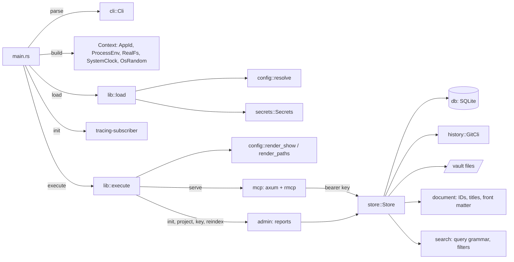
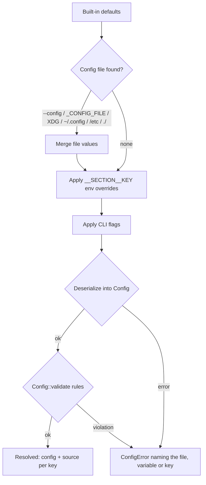

# Architecture

## Overview

`joedocs` is a command-line application split into a thin binary (`src/main.rs`) and a library (`src/lib.rs`) that holds all logic. The library never reads the real process environment, clock or random source directly: they are injected through the `Env`, `FileSystem`, `Clock` and `RandomSource` traits. The document store works on configured directories (temporary ones in tests) and keeps its history behind the `History` trait, implemented with the `git` command line. The design and phases are in [plan.md](plan.md).

## Modules

| Module | Responsibility |
| --- | --- |
| `main.rs` | Parse args, build the real `Context`, load config, start logging, run, map errors to exit codes. |
| `lib.rs` | `load`, `execute`, `open_store` and `catch_up` (the rebuild `serve` runs on start), the `Error` type, exit codes. |
| `cli` | `clap` definitions and conversion of flags to config values. |
| `config` | Schema and defaults (`mod.rs`), resolution (`resolve.rs`), rule checks (`validate.rs`), diagnostics (`show.rs`). |
| `env` | `Env` trait, `ProcessEnv` (process environment over `.env`), `MapEnv` (tests). |
| `fs` | `FileSystem` trait, `RealFs`, `MemFs` (tests). |
| `secrets` | Secrets from the environment, held in `SecretString`. |
| `app_id` | Application name and the environment prefix derived from it. |
| `clock` | `Clock` trait, `SystemClock`, `FixedClock` (tests), RFC 3339 formatting. |
| `document` | Pure domain rules: slugs, project keys, `DocumentId`, titles and file stems, front matter classes, parsing, serialising and change rules. |
| `store` | Document use cases (create, get, update, rename, change front matter, archive, list, search), projects and API keys, the write lock, the integrity guard, the undo journal for vault files, the file → history → database ordering, and `reindex`. |
| `db` | SQLite connection setup, embedded migrations, and queries as free functions over a connection, including the search index (`doc_fields`, `doc_fts`). |
| `history` | `History` trait and `GitCli`, with the git directory outside the vault: commit, show and log. |
| `auth` | API key generation, parsing, hashing and verification; `Permission` and `Grant`; `RandomSource`. |
| `admin` | Text reports for `init`, `project`, `key` and `reindex`. |
| `mcp` | `joedocs serve`: the axum app (`/mcp` behind bearer authentication, `/health`), rmcp's Streamable HTTP service with `Host`/`Origin` checks, the nine tools with JSON schemas, grant checks, audit logging, and error mapping. |
| `search` | Pure: the forgiving query grammar and its FTS5 translation (`query.rs`), and front matter filters, their SQL translation and value flattening (`filter.rs`). |

## Request path

An MCP request first passes the bearer-key middleware, which looks the token up (SHA-256 of the secret) and attaches the key's name and grants to the request. rmcp then checks `Host` and `Origin` and dispatches the tool. Each tool checks the grant for the target project, runs the store operation under the store mutex on a blocking thread, writes an audit entry for changes, and returns structured JSON or a structured error.

## Write path

Every document change takes the write lock (a file lock in the state directory), checks the index's recorded history head against git `HEAD`, and then runs inside one database transaction: validate, check the file on disk still has the hash the index recorded, write the vault file (undoably), commit to git, record the revision and new head, commit the transaction. Any failure before the git commit undoes the file writes and rolls the transaction back. The same transaction replaces the document's search entries: every front matter value in `doc_fields`, and the title, aliases and body in the FTS5 table `doc_fts`. See [plan.md section 11](plan.md#11-write-path-example-update_document).

## Search

`search_documents` parses `query` into a quoted FTS5 expression (so no input is a syntax error) and `filters` into `EXISTS` conditions over `doc_fields`, then runs one SQL query: driven by the FTS5 match when there is text (ranked by `bm25`, title ten times body, with a snippet), otherwise by the documents table, newest first. `"*"` searches every project the key holds a grant on.

## Rebuilding the index

The documents, revisions and search tables are an index of the history: every revision is a commit whose trailers name the document, revision, action and client, and the latest content of each document carries the rest in front matter. `joedocs reindex` replays `git log` into fresh tables in one transaction, recreates projects missing from the database from front matter, and reports vault files that differ from the history. `serve` runs it on start when the index records another history commit than `HEAD` (a write interrupted between the git commit and the database commit) or another index format (a database from an older build), so writes are never left refused.

## Configuration resolution

## Key decisions

- **In-house config resolution.** Precedence, override parsing and provenance are explicit and testable without mutating the process environment, which is `unsafe` in Rust 2024.
- **Every config key has a default.** Defaults define each key's type, which is how environment override strings are parsed.
- **Secrets are separate from config.** They never appear in `config.toml`, overrides or `config show` output.
- **Exit codes follow `sysexits.h`.** `65` for requests the user can fix, `69` when the server cannot listen, `70` for store faults, `74` for output errors, `78` for configuration errors.
- **Git through its command line.** No new crates, and administrators can inspect the history with normal git. The user's git configuration is ignored so hooks and signing cannot interfere.
- **The history is the source of truth.** The database index can always be rebuilt from it; only projects and API keys need a database backup.
