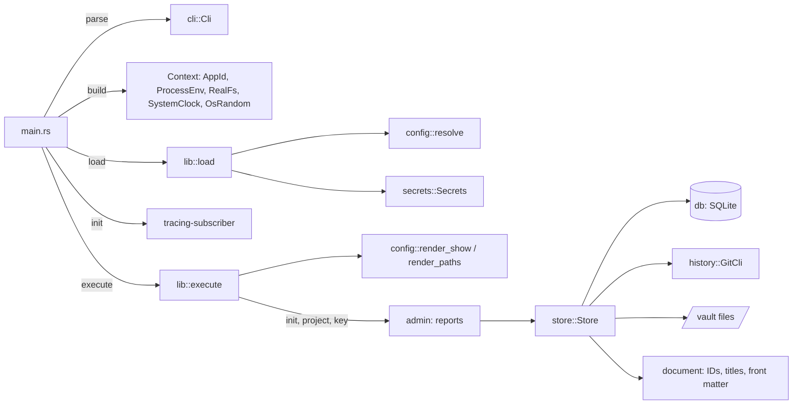
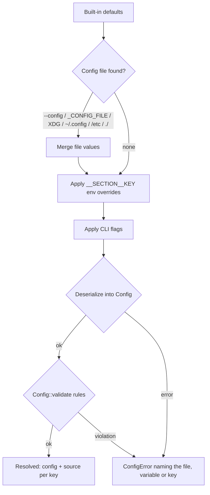

# Architecture

## Overview

`joedocs` is a command-line application split into a thin binary (`src/main.rs`) and a library (`src/lib.rs`) that holds all logic. The library never reads the real process environment, clock or random source directly: they are injected through the `Env`, `FileSystem`, `Clock` and `RandomSource` traits. The document store works on configured directories (temporary ones in tests) and keeps its history behind the `History` trait, implemented with the `git` command line. The design and phases are in [plan.md](plan.md).

## Modules

| Module | Responsibility |
| --- | --- |
| `main.rs` | Parse args, build the real `Context`, load config, start logging, run, map errors to exit codes. |
| `lib.rs` | `load`, `execute` and `open_store`, the `Error` type, exit codes. |
| `cli` | `clap` definitions and conversion of flags to config values. |
| `config` | Schema and defaults (`mod.rs`), resolution (`resolve.rs`), rule checks (`validate.rs`), diagnostics (`show.rs`). |
| `env` | `Env` trait, `ProcessEnv` (process environment over `.env`), `MapEnv` (tests). |
| `fs` | `FileSystem` trait, `RealFs`, `MemFs` (tests). |
| `secrets` | Secrets from the environment, held in `SecretString`. |
| `app_id` | Application name and the environment prefix derived from it. |
| `clock` | `Clock` trait, `SystemClock`, `FixedClock` (tests), RFC 3339 formatting. |
| `document` | Pure domain rules: slugs, project keys, `DocumentId`, titles and file stems, front matter classes, parsing, serialising and change rules. |
| `store` | Document use cases (create, get, update, rename, change front matter, archive, list), projects and API keys, the write lock, the integrity guard, the undo journal for vault files, and the file → history → database ordering. |
| `db` | SQLite connection setup, embedded migrations, and queries as free functions over a connection. |
| `history` | `History` trait and `GitCli`, with the git directory outside the vault. |
| `auth` | API key generation, parsing, hashing and verification; `Permission` and `Grant`; `RandomSource`. |
| `admin` | Text reports for `init`, `project` and `key`. |
| `search`, `mcp` | Empty skeletons for phases 3 and 2; responsibilities are in [plan.md](plan.md#14-code-layout). |

## Write path

Every document change takes the write lock (a file lock in the state directory), checks the index's recorded history head against git `HEAD`, and then runs inside one database transaction: validate, check the file on disk still has the hash the index recorded, write the vault file (undoably), commit to git, record the revision and new head, commit the transaction. Any failure before the git commit undoes the file writes and rolls the transaction back. See [plan.md section 11](plan.md#11-write-path-example-update_document).

## Configuration resolution

## Key decisions

- **In-house config resolution.** Precedence, override parsing and provenance are explicit and testable without mutating the process environment, which is `unsafe` in Rust 2024.
- **Every config key has a default.** Defaults define each key's type, which is how environment override strings are parsed.
- **Secrets are separate from config.** They never appear in `config.toml`, overrides or `config show` output.
- **Exit codes follow `sysexits.h`.** `65` for requests the user can fix, `70` for store faults, `74` for output errors, `78` for configuration errors.
- **Git through its command line.** No new crates, and administrators can inspect the history with normal git. The user's git configuration is ignored so hooks and signing cannot interfere.
