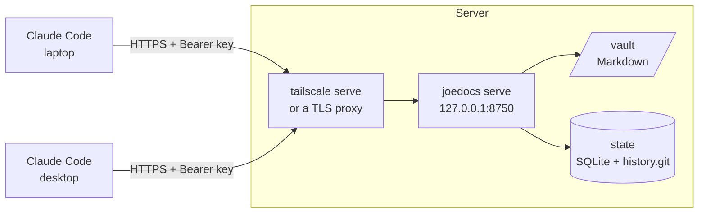

# Deployment guide

How to run JoeDocs as a long-lived server and connect clients to it from other machines. The commands and tools are in [reference.md](reference.md), and every configuration key is in [configuration.md](configuration.md).

A typical setup is one always-on machine (a home server, a VPS, or your desktop) running `joedocs serve`, with every laptop and desktop connecting to it over Tailscale or HTTPS:



## 1. Install

| Platform | Command |
| --- | --- |
| macOS | `brew trust joelee/oss && brew tap joelee/oss && brew install joelee/oss/joedocs` |
| Linux or macOS | `cargo install joedocs --locked` (Rust 1.99 or newer and a C compiler; installs to `~/.cargo/bin`) |
| Docker | Build from a clone with the `Dockerfile` and `compose.yaml` (see the [developer guide](developer-guide.md#running-with-docker)) |

JoeDocs needs `git` at run time (`sudo pacman -S git`, `sudo apt install git`, or the Xcode Command Line Tools on macOS).

## 2. Configure

Put the configuration in `~/.config/joedocs/config.toml`, which JoeDocs finds on its own (`joedocs config paths` shows the search order):

```toml
[log]
level = "info"

[server]
bind = "127.0.0.1:8750"
# Host names clients use to reach the server: loopback, plus your public or tailnet name.
allowed_hosts = ["localhost", "127.0.0.1", "::1", "docs.example.ts.net"]

[storage]
home = "/home/you/Documents/JoeDocs"           # the vault: Markdown only
state_dir = "/home/you/.local/state/joedocs"    # database and history; never synced
```

- `storage.home` must be an absolute path, and empty or absent before `joedocs init`. Leave `state_dir` empty to use `~/.local/share/joedocs`.
- Keep `bind` on loopback when a proxy or `tailscale serve` sits in front. Add each name clients use to `allowed_hosts`, or their requests get `403`.
- Check the result with `joedocs config show`: each value says which layer set it.

## 3. Create the store, projects and keys

Run these as the account that will run the server:

```bash
joedocs init
joedocs project add my-app --key MA --title "My app"
joedocs project add notes --key NT --title Notes
joedocs key create laptop --grant my-app:write --grant notes:write
```

`key create` prints the token once, alone on its last line, so a script can capture it with `| tail -n 1`. Create one key per machine or agent: the key name is recorded as the author of every change, and you can revoke one machine without touching the others.

## 4. Run it as a service

### Linux (systemd)

`joedocs systemd install` writes a unit that runs `joedocs serve`, then reloads systemd, enables the unit and (re)starts it. systemd does not see your shell, so the unit pins the configuration in effect: the config file in use (`JOEDOCS_CONFIG_FILE`), every key set by an environment override or flag, and the absolute storage paths. Run `joedocs init` first; install refuses an uninitialised store.

A **user service** runs as you. Run these from a real login session (SSH or a desktop, not `su`), with no `JOEDOCS__` variables set unless you mean to pin them:

```bash
joedocs systemd install --dry-run           # show the unit and the commands first
joedocs systemd install                     # ~/.config/systemd/user/joedocs.service
sudo loginctl enable-linger "$USER"         # start at boot and keep running after logout
systemctl --user status joedocs
journalctl --user -u joedocs -f
curl -s http://127.0.0.1:8750/health        # ok
```

A **system service** runs as a dedicated account and is sandboxed so it can write only the vault and the state directory (`ProtectSystem=strict`, `ReadWritePaths=`, and similar):

```bash
sudo joedocs --config /etc/joedocs/config.toml systemd install --system --run-as joedocs
sudo systemctl status joedocs
```

`sudo` resets your environment, so give the configuration through `--config` (or `/etc/joedocs/config.toml`, which the lookup finds anyway) rather than environment variables, and check the result with `--dry-run`. The account must be able to write the storage paths.

`joedocs systemd remove` (with `--system` for a system unit) stops, disables and deletes the unit. A unit file that `joedocs systemd install` did not write is never overwritten or removed.

### macOS (Homebrew)

The Homebrew formula includes a service that runs `joedocs serve` at login:

```bash
brew services start joedocs
brew services info joedocs
tail -f "$(brew --prefix)/var/log/joedocs.log"
curl -s http://127.0.0.1:8750/health        # ok
```

It reads `~/.config/joedocs/config.toml` like any other run. After changing the configuration, run `brew services restart joedocs`; `brew services stop joedocs` stops it. With a Cargo install instead, run `joedocs serve` from a launchd agent of your own.

### Docker

`compose.yaml` runs the server in a container with the vault and state bind-mounted from `.local/data`. It is meant for local trials and the deployment tests; see the [developer guide](developer-guide.md#running-with-docker).

## 5. Reach it from other machines

JoeDocs speaks plain HTTP and does not handle TLS itself. Put one of these in front of it.

**Tailscale (recommended for personal use).** Every device on your tailnet can reach the server, nothing is exposed to the internet, and Tailscale provides the certificate:

```bash
sudo tailscale serve --bg 8750     # https://<machine>.<tailnet>.ts.net → http://127.0.0.1:8750
tailscale serve status
```

Add `<machine>.<tailnet>.ts.net` to `server.allowed_hosts`. If HTTPS certificates are not enabled for your tailnet yet, the command prints a link to enable them. The setting survives reboots.

Without `tailscale serve`, set `bind` to the machine's Tailscale address (`tailscale ip -4`) and connect with `http://<machine>.<tailnet>.ts.net:8750/mcp`. WireGuard still encrypts the traffic.

**A TLS reverse proxy.** For example, with Caddy, which gets the certificate itself:

```text
docs.example.net {
    reverse_proxy 127.0.0.1:8750
}
```

Add `docs.example.net` to `server.allowed_hosts`. If a browser-based client connects, also add its origin to `server.allowed_origins`.

## 6. Connect clients

**Claude Code**, with user scope so every project on the machine sees it and the token stays outside any repository:

```bash
claude mcp add --transport http --scope user joedocs https://docs.example.ts.net/mcp \
  --header "Authorization: Bearer jd_..."
claude mcp get joedocs        # Connected
```

In a session, `/mcp` should list fifteen JoeDocs tools. Ask *"List my JoeDocs projects"* to check the key's grants.

To create a key from the client machine without copying it by hand, run `key create` over SSH and capture the last line (non-interactive SSH may not have `~/.cargo/bin` on `PATH`, so give the full path):

```bash
TOKEN=$(ssh you@server '~/.cargo/bin/joedocs key create laptop --grant my-app:write' | tail -n 1)
```

**Keep the key out of files you might commit.** Put it in an environment variable, or in a client's user-level config outside any repository. Never put it in a project-level client config, such as an `opencode.json` or `.codex/config.toml` inside a repository: one `git add .` commits it. The examples below read the key from `JOEDOCS_API_KEY`. Fill that variable from a password manager when you start the client, for example with [`pass`](https://www.passwordstore.org/):

```bash
export JOEDOCS_API_KEY="$(pass show joedocs/token)"
```

The same substitution works for Claude Code: `--header "Authorization: Bearer $(pass show joedocs/token)"` stores the key in your user-level `~/.claude.json`, not in the project.

**OpenCode** replaces `{env:NAME}` in its config. In the global config, `~/.config/opencode/opencode.json`:

```json
{
  "$schema": "https://opencode.ai/config.json",
  "mcp": {
    "servers": {
      "joedocs": {
        "type": "remote",
        "url": "https://docs.example.ts.net/mcp",
        "oauth": false,
        "headers": {
          "Authorization": "Bearer {env:JOEDOCS_API_KEY}"
        }
      }
    }
  }
}
```

`"oauth": false` stops OpenCode trying OAuth, which JoeDocs does not offer. If the variable is not set, OpenCode sends an empty value and the server answers `401 Unauthorized`.

**Codex** sends the variable named by `bearer_token_env_var` as the bearer token. In `~/.codex/config.toml`:

```toml
[mcp_servers.joedocs]
url = "https://docs.example.ts.net/mcp"
bearer_token_env_var = "JOEDOCS_API_KEY"
```

**Other MCP clients** need the Streamable HTTP URL (`https://<host>/mcp`) and the header `Authorization: Bearer <token>`. If the client can read the header or token from the environment, use that rather than writing the key into its config.

## 7. Operate

| Task | How |
| --- | --- |
| Upgrade | `brew upgrade joedocs && brew services restart joedocs`, or `cargo install joedocs --locked && systemctl --user restart joedocs`. `serve` rebuilds the index on start if the database is from an older build. |
| Change the configuration | Edit `config.toml`, then restart the service. Rerun `joedocs systemd install` only if you moved the binary or changed what the unit pins (the config file path, overrides, storage paths). |
| Give a machine access | `joedocs key create NAME --grant PROJECT:PERMISSION`, or `joedocs key grant NAME PROJECT:PERMISSION` for an existing key. |
| Replace a leaked token | `joedocs key rotate NAME`, then update the client's header. `joedocs key revoke NAME` cuts a machine off for good. |
| Bring back an archived document | `joedocs archive list`, then `joedocs archive restore JD-42`. |
| Back up | `joedocs backup ~/joedocs-$(date +%F).tgz`, safe while the service runs. Keep the file private: it holds API key hashes. |
| Check consistency | `joedocs check` (exits `1` if it finds problems, and says how to fix each). `joedocs reindex` rebuilds the index from the history. |
| Back up | Back up `state_dir` (the database holds the projects and keys; `history.git` holds every revision) and the vault. The document index can be rebuilt from `history.git` alone. |
| Browse in Obsidian | Copy the vault one way into an Obsidian vault on a schedule, for example `rsync -a --delete <home>/ <obsidian-vault>/JoeDocs/`. Edit through JoeDocs, not in the vault: JoeDocs refuses to overwrite files changed behind its back. |

## Troubleshooting

| Symptom | Cause and fix |
| --- | --- |
| `403 Forbidden` | The `Host` the client used is not in `server.allowed_hosts` (or its `Origin` is not in `server.allowed_origins`). Add it and restart. |
| `401 Unauthorized` | The token is wrong, rotated or revoked. Check with `joedocs key list`. |
| `Failed to connect to bus` from `systemctl --user` | Not a real login session (for example after `su`). Log in over SSH as that user. |
| The service stops at logout | Enable lingering: `sudo loginctl enable-linger "$USER"`. |
| Exit code `78` on start | A configuration error; the message names the file, variable or key. `joedocs config show` shows every value and its source. |
| `integrity` errors from tools | A vault file was edited outside JoeDocs. `joedocs check` lists it and gives the git command that discards the change. |
