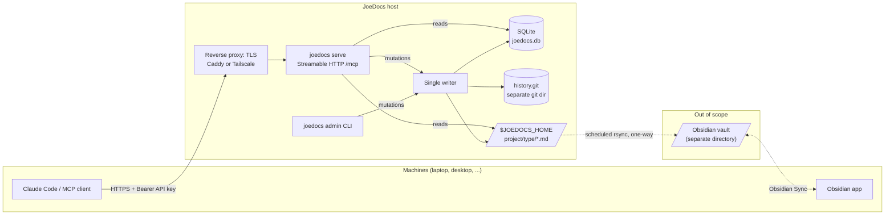

# JoeDocs: initial plan

Status: **phases 0 and 1 done**. The configuration, the document store, git history, the SQLite index and the admin `init`/`project`/`key` commands are implemented; the MCP server (phase 2) and later phases are not. Choices made while building phase 1 are recorded in section 17. Answers from the first review are recorded in section 17. Items still marked **Proposed** have not been explicitly confirmed.

## 1. Goal

One central server that holds every project's documentation (plans, ideas, issues, reviews, research, specs, and so on) so that coding agents on any of my machines can read and write it over MCP, and so that I can browse it all as one Obsidian vault.

In scope:

- An MCP server reachable over the network, used by MCP clients (Claude Code and others) on several computers.
- Documents stored as Obsidian-style Markdown with YAML front matter. Mermaid and PlantUML fenced blocks are kept as written.
- A SQLite database for metadata: projects, API keys, the document index, the revision index and search.
- API keys scoped to one or more projects.
- Full version history, and archiving that an administrator can recover from.

Out of scope for v1: a web UI, attachments and images, multi-user accounts beyond API keys, and semantic or embedding search.

## 2. System overview



Obsidian is outside this project's scope. A scheduled one-way `rsync` copies `$JOEDOCS_HOME` into a separate Obsidian vault, and Obsidian Sync takes it from there. **JoeDocs is the only writer of `$JOEDOCS_HOME`** (see section 12).

### Directories on the server

```text
$JOEDOCS_HOME/                    Content only; rsync source for the Obsidian vault
├── joedocs/                      one folder per project
│   ├── home/
│   │   └── JoeDocs.md
│   ├── plans/
│   │   └── Initial plan.md
│   └── issues/
└── another-project/
    └── ...

$JOEDOCS_STATE/                   Never synced
├── joedocs.db                    SQLite (WAL mode)
├── history.git/                  git dir whose work tree is $JOEDOCS_HOME
└── joedocs.lock                  lock that serialises all writers
```

`$JOEDOCS_HOME` is the config key `storage.home` (override `JOEDOCS__STORAGE__HOME`), and `$JOEDOCS_STATE` is `storage.state_dir`.

Keeping the database and the git directory **outside** `$JOEDOCS_HOME` means a plain `rsync` of it copies only Markdown, with no excludes needed. Git supports this layout directly: `git --git-dir=$JOEDOCS_STATE/history.git --work-tree=$JOEDOCS_HOME`.

## 3. Requests (MCP tools)

All tools return structured JSON (MCP `structuredContent` with an `outputSchema`) and a short text summary. Read tools carry `readOnlyHint`, and `archive_document` carries `destructiveHint`. Every call is authorised against the projects the API key may access. A document in a project the key cannot see looks the same as a missing document, so its existence does not leak.

### Requested by you (signatures refined)

| Tool | Parameters | Returns | Notes |
| --- | --- | --- | --- |
| `list_documents` | `project`, `type="all"`, `status?`, `limit=200`, `start=1`, `sort="updated_desc"` | `items[]` (id, title, type, status, revision, updated, updated_by), `total`, `next_start` | No content. `start` is a 1-based offset. |
| `get_document` | `document_id`, `version="latest"` or a revision number | `markdown` (front matter and body), `metadata` | An archived document returns an `archived` error. |
| `new_document` | `project`, `type="home"`, `status="draft"`, `title`, `content`, `front_matter?`, `summary?` | `document_id`, `revision: 1`, `path` | `content` is the body only. `front_matter` holds custom keys. |
| `update_document` | `document_id`, `content`, `expected_revision`, `front_matter?`, `summary?` | `revision` | `expected_revision` is **required**, because a full replacement could silently discard an edit made by an agent on another machine. If it is stale, the tool returns `conflict` with the current revision so the agent can re-read and merge. `front_matter` keys are merged as in `change_document_front_matter`. `summary` becomes the commit message. |
| `rename_document` | `document_id`, `title`, `expected_revision?` | `revision`, `path` | Moves the file. The old title goes into `aliases`. |
| `change_document_front_matter` | `document_id`, `set?` (JSON object), `remove?` (list of keys), `expected_revision?` | `revision`, `front_matter` | Only the named keys change. `remove` deletes **custom** keys only. Reserved keys can never be removed, and the server-owned ones cannot be set either (see section 5). `null` in `set` is rejected; use `remove` instead. Every change is a revision, so `diff_document` shows exactly which keys changed or were removed. |
| `archive_document` | `document_id`, `reason` | `archived_at` | Removes the file from the vault and the document from list and search results. An administrator can restore it. |
| `search_documents` | `project` (or `"*"` for every project the key can read), `type="all"`, `query`, `filters?`, `limit=200` | `items[]` with `project`, `snippet` and `score` | See section 7. |

### Proposed additions

| Tool | Why |
| --- | --- |
| `list_projects` | Discovery: the projects this key can access, with permission, document types, allowed statuses and document counts. Agents call this first. |
| `get_document_history` | The revisions of a document: revision, time, client, action and summary. |
| `diff_document` | A unified diff between two revisions, so an agent can see what changed since it last read the document. |
| `restore_document_version` | Makes an old revision the new latest revision. Nothing is rewritten. |
| `move_document` | Changes the document type (folder), for example from `ideas` to `plans`. |
| `edit_document` | Applies exact `old`/`new` string replacements (like an editor's search-and-replace) without resending the whole document. This saves tokens and avoids clobbering on large docs. |
| `append_to_document` | Appends a section, for example a comment on an issue or a log entry. |

Admin operations are deliberately **not** MCP tools in v1. They run through the CLI on the server host: registering projects, creating, granting and revoking keys, listing and restoring archives, reindexing and integrity checks. This keeps a leaked client key from escalating.

```text
joedocs init                                   create state dir, DB, git repo
joedocs serve                                  run the MCP server
joedocs project add <name> --key JD [--title ...]
joedocs project list
joedocs key create <name> --grant joedocs:write --grant other:read   (prints the key once)
joedocs key list | grant | revoke
joedocs archive list [--project P]
joedocs archive restore <document-id>
joedocs reindex                                rebuild the DB index and FTS from the files and git
joedocs check                                  report drift between files, git and the DB
joedocs config show | paths
```

## 4. Document identity and file names

**Proposed:** each project is registered with a short, immutable **key** (for example `JD`). Document IDs are `<KEY>-<n>`, as in `JD-42`, allocated per project. IDs are:

- short, so they are cheap for agents to repeat and easy to read in Obsidian,
- stable across renames, type moves and edits,
- self-routing, since the prefix identifies the project for authorisation.

(The alternative is a ULID such as `01JB...`. It is globally unique without a counter but unfriendly to humans.)

**File name = sanitised title**, `$JOEDOCS_HOME/<project>/<type>/<Title>.md`, because Obsidian treats the file name as the note title and as the `[[wiki link]]` target. Sanitising strips the characters Obsidian rejects (`* " \ / < > : | ? # ^ [ ]`) and trims the length. A clash within a folder gets ` (JD-42)` appended. The database maps ID to path, and the ID is also written into the front matter, so the mapping can be rebuilt from the files alone.

Project names are slugs (`[a-z0-9][a-z0-9-]*`), because they are directory names. Document types come from a configured list (see section 9), so agents cannot invent `plan`, `Plans` and `planning` side by side.

## 5. Front matter

```yaml
---
id: JD-42                         # reserved, read-only
title: Search query language      # reserved, changed only by rename_document
project: joedocs                  # reserved, read-only
type: specs                       # reserved, changed only by move_document
status: approved                  # reserved, writable, validated against config
revision: 4                       # reserved, read-only
created: 2026-11-04T09:12:03Z     # reserved, read-only (publish time)
created_by: laptop                # reserved, read-only (API key name)
updated: 2026-11-05T14:40:10Z     # reserved, read-only
updated_by: desktop               # reserved, read-only (API key name)
client: claude-code               # reserved, read-only (MCP clientInfo.name of the last writer)
aliases: [Search syntax]          # Obsidian key; the server appends old titles on rename
tags: [search, fts]               # Obsidian key; client-writable
approved_by: joel                 # custom, kept as-is (client-asserted)
---
```

Rules:

- **Flat keys, no `joedocs:` namespace.** Obsidian's Properties panel and Dataview handle flat scalar and list keys well but not nested maps.
- There are three classes of key:
  - **Server-owned** keys (`id`, `project`, `type`, `title`, `revision`, `created*`, `updated*`, `client`) change only as a side effect of the matching tool. They can never be set or removed directly.
  - **Validated** keys (`status`, `tags`, `aliases`) can be set by clients but are checked, and they can never be removed.
  - **Custom** keys are everything else. Clients can set and remove them freely, and git history audits every change.
- **Approval is a status change.** Any key with `write` on the project can set `status: approved`. In v1 the trustworthy record of who did it is the revision history (the commit author is the API key name). A custom `approved_by` is client-asserted and unverified. Server-stamped approval fields and an `approve` grant are on the [backlog](backlog.md).
- Who wrote a revision comes from the **API key's registered name**, not from anything the client claims. The MCP `clientInfo.name` is recorded separately as `client`.
- The server owns the serialised form. Server keys come first in a fixed order, then custom keys in their insertion order. Comments inside client-supplied YAML are not preserved.
- Timestamps are UTC RFC 3339. This still needs checking against how Obsidian's datetime property displays them.

## 6. Versioning: git as the history store (Decision 1)

**Proposed: yes, one git commit per revision**, with the git dir kept outside the vault (section 2).

How it works:

1. Every mutation (new, update, rename, front matter change, move, archive, restore) is one revision and one commit. The front matter's `revision` field is that counter. `get_document(id, version=3)` therefore always exists.
2. The `revisions` table maps `(document_id, revision)` to `(commit_sha, path_at_that_revision)`. Reading an old version is `git show <sha>:<path>` with no `--follow` guessing across renames.
3. The commit author is the API key name. The message is the client's `summary` plus machine-readable trailers:

   ```text
   Update JD-42: tighten FTS grammar

   JoeDocs-Document: JD-42
   JoeDocs-Revision: 4
   JoeDocs-Action: update
   JoeDocs-Client: claude-code
   ```

   Together with the front matter, the trailers make the whole document index **rebuildable from git** (`joedocs reindex`). Only projects and API keys live solely in SQLite, so back up the database.
4. **Archive** is `git rm` plus a commit with `JoeDocs-Action: archive` and the reason, and the DB row is marked archived. **Restore** (admin CLI) checks the file out from the parent of the archive commit, writes it back to its old path (or a suffixed one if that path is taken) and commits. Nothing is ever lost, and the vault stays clean.
5. All writes go through **one writer**: a single task inside `serve`, plus a file lock (`std::fs::File::lock`) so that the admin CLI and the server never write at the same time. This removes git index races and makes "write file, commit, update DB" a strict sequence.
6. **Crash consistency.** Git and the files are the source of truth for content, and the DB is an index. On startup the server compares git `HEAD` with the last commit recorded in the DB and replays any commits it is missing.
7. **Off-site backup** (later): optionally `git push` the history to a private remote after each commit.

Git implementation choice:

| Option | For | Against |
| --- | --- | --- |
| **`git` CLI behind a `History` trait** (proposed) | Battle-tested; zero new crates; admins can inspect with normal git; easy to fake in unit tests | Needs `git` installed; one subprocess per write (a few ms) |
| `gix` (gitoxide) | Pure Rust | Large dependency tree; higher-level write and checkout APIs are still settling |
| `git2` (libgit2) | Mature | C dependency, and its licence (GPL-2.0 with linking exception) needs a `deny.toml` change |
| No git: revisions as rows in SQLite | One transactional store | No diff, blame or push tooling; the history is opaque outside JoeDocs |

## 7. Search (Decision 2)

**Proposed:** SQLite **FTS5** (built into `rusqlite`'s bundled SQLite) for text, plus plain SQL over a flattened front matter table for fields. Agents get two parameters, because LLMs fill structured JSON arguments more reliably than they write a query language:

```json
{
  "project": "joedocs",
  "type": "all",
  "query": "\"rate limit\" retry -redis auth*",
  "filters": {
    "status": "approved",
    "tags": { "contains": "security" },
    "updated": { "gte": "2026-10-01" },
    "approved_by": "joel"
  },
  "limit": 20
}
```

- `query` is a small, forgiving grammar: bare words, `"phrases"`, `-exclude`, `prefix*`, `OR`. JoeDocs parses it and **generates** the FTS5 expression, so an unbalanced quote never becomes a SQL error. Title matches rank above body matches (`bm25` column weights). Each result carries an FTS5 `snippet()`. An empty `query` with `filters` alone is a pure metadata query.
- `filters` is an object keyed by front matter key. A plain value means equality. The operator objects are `eq`, `ne`, `in`, `contains` (for list keys like `tags`), `gt`/`gte`/`lt`/`lte` (for dates and numbers) and `exists`. Reserved and custom keys work the same way, because every front matter key is flattened into `doc_fields(document_id, key, value)`. List values become one row per item.
- Only the **latest** revision of non-archived documents is indexed. Searching history can come later.
- Later: embedding search (for example `sqlite-vec`) for "find things like this" queries.

## 8. Authentication and transport

- **Transport: MCP Streamable HTTP** on a single `/mcp` endpoint (the current spec transport; the older HTTP+SSE transport is deprecated). It binds to `127.0.0.1` by default. TLS is terminated by a reverse proxy, or the server is reached over Tailscale, so JoeDocs does not ship TLS or certificate code. The server validates the `Origin` header, as the MCP spec requires, to block DNS rebinding.
- **API keys:** clients send `Authorization: Bearer jd_<id>_<secret>`. The key is 32 random bytes and is shown once at creation. The DB stores only `id` and `SHA-256(secret)`. A slow hash is unnecessary for high-entropy random keys. Keys carry a name (used as `created_by` and `updated_by`) and per-project grants of `read` or `write`. Revocation takes effect immediately, and `last_used_at` is recorded.
- **Client setup** (Claude Code example):
  `claude mcp add --transport http joedocs https://docs.example.net/mcp --header "Authorization: Bearer jd_..."`
- **Limits:** a maximum document size (default 1 MiB) and a request body limit. Every mutation is written to an audit log.

## 9. Configuration (non-secret, `config.toml`)

This follows the template's rules: every key has a default and a `JOEDOCS__SECTION__KEY` override. Everything except `[history]` is implemented (phase 0); [configuration.md](configuration.md) is the reference.

```toml
[log]
level = "info"

[server]
bind = "127.0.0.1:8750"
allowed_origins = []              # extra Origin values to accept
max_document_bytes = 1048576

[storage]
home = ""                         # the vault ($JOEDOCS_HOME); empty = required at `init`/`serve`
state_dir = ""                    # DB + history.git; empty = $XDG_DATA_HOME/joedocs or ~/.local/share/joedocs

[documents]
types = ["home", "plans", "ideas", "issues", "reviews", "research", "specs", "notes"]
statuses = ["draft", "review", "approved", "rejected", "superseded", "done"]
default_type = "home"
default_status = "draft"

[history]                         # phase 5
remote = ""                       # optional push target for off-site backup
```

The server needs no secrets of its own, because client keys live hashed in the DB. The template's example `JOEDOCS_API_TOKEN` will be removed.

## 10. SQLite schema (first draft)

```sql
CREATE TABLE projects (
  id INTEGER PRIMARY KEY, name TEXT NOT NULL UNIQUE, key TEXT NOT NULL UNIQUE,
  title TEXT NOT NULL, next_seq INTEGER NOT NULL DEFAULT 1, created_at TEXT NOT NULL
);
CREATE TABLE api_keys (
  id TEXT PRIMARY KEY, name TEXT NOT NULL UNIQUE, secret_sha256 BLOB NOT NULL,
  created_at TEXT NOT NULL, last_used_at TEXT, revoked_at TEXT
);
CREATE TABLE grants (
  api_key_id TEXT NOT NULL REFERENCES api_keys(id), project_id INTEGER NOT NULL REFERENCES projects(id),
  permission TEXT NOT NULL CHECK (permission IN ('read', 'write')), PRIMARY KEY (api_key_id, project_id)
);
CREATE TABLE documents (
  id TEXT PRIMARY KEY, project_id INTEGER NOT NULL REFERENCES projects(id), type TEXT NOT NULL,
  title TEXT NOT NULL, path TEXT NOT NULL UNIQUE, status TEXT NOT NULL, revision INTEGER NOT NULL,
  created_at TEXT NOT NULL, created_by TEXT NOT NULL, updated_at TEXT NOT NULL, updated_by TEXT NOT NULL,
  content_sha256 BLOB NOT NULL, archived_at TEXT, archived_by TEXT, archive_reason TEXT
);
CREATE TABLE revisions (
  document_id TEXT NOT NULL REFERENCES documents(id), revision INTEGER NOT NULL,
  commit_sha TEXT NOT NULL, path TEXT NOT NULL, action TEXT NOT NULL, author TEXT NOT NULL,
  client TEXT NOT NULL, summary TEXT NOT NULL, created_at TEXT NOT NULL,
  PRIMARY KEY (document_id, revision)
);
CREATE TABLE doc_fields (document_id TEXT NOT NULL, key TEXT NOT NULL, value TEXT NOT NULL);
CREATE INDEX doc_fields_kv ON doc_fields (key, value);
CREATE VIRTUAL TABLE doc_fts USING fts5 (document_id UNINDEXED, title, body, tokenize = 'porter unicode61');
CREATE TABLE audit_log (at TEXT NOT NULL, api_key_id TEXT, tool TEXT NOT NULL, document_id TEXT, outcome TEXT NOT NULL);
```

Migrations are plain `.sql` files embedded with `include_str!`, versioned with `PRAGMA user_version`; no migration crate is needed. Phase 1 created [`src/db/migrations/0001_core.sql`](../src/db/migrations/0001_core.sql), which differs from this draft as follows:

- Tables are `STRICT`.
- `documents` gains `seq` (for ordering and per-project uniqueness) and `client` (the last writer's client, written to front matter). The unique path constraint is a partial index over live documents, compared without ASCII case, so archiving frees a path.
- `revisions.commit_sha` is named `commit_id`.
- A `meta` table holds `history_head`, the history commit the index reflects.
- `doc_fields` and `doc_fts` arrive with search (phase 3), and `audit_log` with the MCP server (phase 2).

## 11. Write path (example: `update_document`)

```mermaid
sequenceDiagram
    participant C as MCP client
    participant M as mcp (tool handler)
    participant A as auth
    participant W as store writer
    participant F as vault file
    participant G as history (git)
    participant D as SQLite
    C->>M: update_document(JD-42, content, expected_revision=3)
    M->>A: key may write project of JD-42?
    A-->>M: yes (key "laptop")
    M->>W: UpdateCommand
    W->>D: current revision == 3?
    W->>F: write front matter (revision 4, updated, updated_by) + body
    W->>G: add + commit (author laptop, trailers)
    G-->>W: sha
    W->>D: BEGIN; update documents, revisions, doc_fields, doc_fts; COMMIT
    W-->>M: revision 4
    M-->>C: { revision: 4 }
```

## 12. Obsidian (Decision 3)

Obsidian is out of scope. A scheduled one-way `rsync` from `$JOEDOCS_HOME` into a separate Obsidian vault feeds Obsidian Sync. Consequences for JoeDocs:

- **JoeDocs is the only writer of `$JOEDOCS_HOME`.** It contains no Obsidian-specific code and does not reconcile external edits.
- **Edits made in Obsidian do not come back.** The next rsync overwrites them. That is acceptable, because changes go through MCP tools.
- **Archived documents vanish from the vault** only if rsync runs with `--delete`. That flag is recommended, so the vault mirrors the document list.
- **Integrity guard (phase 1).** Before every mutation, the writer compares the file's hash with `content_sha256`. On a mismatch it refuses the change with an `integrity` error rather than overwrite something it did not write. `joedocs check` reports such drift.

Mermaid renders natively in Obsidian. PlantUML needs the community PlantUML plugin. JoeDocs stores both fence types untouched, and the tool descriptions will tell agents to use them.

## 13. Crates (audited and approved 2026-11-04)

Audited with `cargo deny` against the current `deny.toml` (RustSec DB of 2026-11-03), without building anything. Option A below was approved on 2026-11-04 and `BSD-3-Clause` was added to the `deny.toml` allow-list. Each crate is added in the phase that first uses it.

| Crate | Version | Features | Licence | Purpose |
| --- | --- | --- | --- | --- |
| `rmcp` | 3.8.0 | no defaults; `server`, `macros`, `transport-streamable-http-server` | Apache-2.0 | MCP server; `StreamableHttpService` is a tower service |
| `rmcp` (dev) | 3.8.0 | no defaults; `client`, `transport-streamable-http-client-reqwest` (no TLS) | Apache-2.0 | End-to-end tests; adds about 35 crates, no new licences |
| `schemars` | 1.2.3 | (via rmcp) | MIT | Tool input schemas |
| `tokio` | ≥ 1.54.1 | `rt-multi-thread`, `macros`, `net`, `signal`, `sync`, `time` | MIT | Runtime; 1.54.1 fixes RUSTSEC-2026-0384/0386 |
| `axum` | 0.8.9 | no defaults; `http1`, `tokio`, `json` | MIT | HTTP routing, auth middleware, graceful shutdown (option A, chosen) |
| `hyper` + `hyper-util` | 1.12.0 / 0.1.21 | `server`, `http1` / `tokio`, `server`, `service`, `server-graceful` | MIT | Instead of axum (option B, not chosen); bearer auth becomes a hand-written tower wrapper |
| `rusqlite` | 0.41.1 | no defaults; `bundled` (SQLite 3.54.1), `fallible_uint` (no extra crates) | MIT | `libsqlite3-sys` build.rs sets `-DSQLITE_ENABLE_FTS5`. Defaults stay off: `cache` pulls `foldhash` (Zlib) |
| `serde_json` | 1.0.154 | default | MIT OR Apache-2.0 | Tool arguments and results. `preserve_order` is not used: it now pulls `foldhash` (Zlib), which the allow-list does not include |
| `indexmap` | 2.14.2 | no defaults; `std`, `serde` | Apache-2.0 OR MIT | Front matter in key order (added in phase 1 instead of `preserve_order`) |
| `sha2` | 0.11.1 | no defaults | MIT OR Apache-2.0 | API key hashing |
| `getrandom` | 0.4.3 | default | MIT OR Apache-2.0 | API key generation |
| `jiff` | 0.2.39 | no defaults; `std` | Unlicense OR MIT | Timestamps (2 crates, against 5 for `time`) |
| YAML | see below | | | Front matter |

**Licences.** The only addition any choice forces is `BSD-3-Clause`. It comes from `matchit 0.8.4` (`MIT AND BSD-3-Clause`), which axum pins and cannot drop. Without axum, the whole set passes the current allow-list.

**YAML.** `serde_yaml` is archived. `serde_yml` and `libyml` are flagged unsound, and `serde_yaml_ng` fails on the unmaintained `unsafe-libyaml`. The two credible candidates are:

| | `serde-saphyr` 2.1.0 (chosen) | `yaml_serde` 0.10.7 |
| --- | --- | --- |
| Maintenance | Most active (about 12M recent downloads) | The YAML organisation's continuation of serde_yaml |
| Safety | `#![forbid(unsafe_code)]` | Built on `libyaml-rs`: libyaml translated by c2rust, contains `unsafe`, quiet repo |
| Key order | Through the target type (JoeDocs uses `IndexMap<String, serde_json::Value>`) | Its own `Mapping` is an `IndexMap` |
| Licence impact | Needs `BSD-3-Clause` (via `encoding_rs`) | None |

**Options:**

- **A (chosen 2026-11-04): allow `BSD-3-Clause`, and use axum and `serde-saphyr`.** That is one widely used permissive licence. It buys less hand-written HTTP code and a YAML parser with no unsafe code. Front matter is modelled as an `IndexMap<String, serde_json::Value>`, which keeps key order and is what MCP tools send and receive.
- **B (not chosen): no `deny.toml` change, and use hyper and `yaml_serde`.** The cost is a hand-written bearer-auth tower wrapper and a YAML stack that contains unsafe code and has little visible maintenance.

**Other findings:**

- rmcp's `allowed_hosts` defaults to loopback only (DNS-rebinding protection). Behind a reverse proxy, the public host name must be allowed, so phase 2 adds a `server.allowed_hosts` key.
- rmcp's `build.rs` may spawn `git config` (a no-op for registry builds).
- The only real duplicate is `syn` 2 and 3, a build-time cost only.

## 14. Code layout

The skeleton modules now exist in `src/` (see [directory-structure.md](directory-structure.md)):

| Module | Responsibility |
| --- | --- |
| `document` | Domain types (`ProjectName`, `DocType`, `DocumentId`, `Status`, `Revision`), front matter parse/serialise with reserved-key rules, title to file name sanitising. Pure, no I/O. |
| `store` | The use cases behind every tool (create, update, rename, ...), the single writer, and the ordering of file, git and DB steps. |
| `db` | SQLite connection setup (WAL, foreign keys), embedded migrations, queries. |
| `history` | The `History` trait and its `git` CLI implementation. |
| `search` | The query grammar parser, FTS5 expression generation, and filter-to-SQL translation. |
| `auth` | API key generation, hashing, verification, and grant checks. |
| `mcp` | The rmcp server, tool schemas and handlers, the HTTP transport, the bearer auth and Origin middleware, and mapping errors to MCP results. |
| `admin` | The admin CLI commands (`init`, `project`, `key`, `archive`, `reindex`, `check`). |

Time and randomness will be injected (`Clock` and key-generator traits) like `Env` and `FileSystem`, so tests stay deterministic.

## 15. Phases

| Phase | Deliverable | Done when |
| --- | --- | --- |
| 0. Foundations | Remove the `greet` example; add the `server`, `storage` and `documents` config; approve dependencies and `deny.toml` | `just ci` is green with the real config schema (done); dependencies approved (done) |
| 1. Core store (no network) | `Clock` trait (moved from phase 0, so it lands with its first user and the chosen time crate); `document` types and front matter; `db` schema and migrations; `history` via git; `store` create, get, update, rename, front matter (set and remove), archive and list; the integrity guard; `admin init/project/key` | Integration tests drive the store against a temp vault and real git, including a file edited behind the store's back (done) |
| 2. MCP over HTTP | `serve`, bearer auth, Origin check, the section 3 tools, structured errors | An rmcp client in tests round-trips every tool, and Claude Code connects for real |
| 3. Search | FTS5 index, query grammar, filters, snippets, `reindex` | Search tests over a fixture vault |
| 4. History and editing tools | `get_document_history`, `diff_document`, `restore_document_version`, `move_document`, `edit_document`, `append_to_document`, `list_projects`, `archive list/restore`, `check` | |
| 5. Operations | systemd unit, deploy guide (Caddy/Tailscale), optional `git push` backup, DB backup command | Running on the real server |
| Later | Approval provenance (server-stamped `status_changed`/`status_changed_by`, `approve` grant for protected statuses); per-type templates (MCP prompts); documents as MCP resources; backlinks; embedding search; attachments; secret scanning on write | |

## 16. Risks

- **Secrets pasted into documents live in git history forever.** Removing them needs a history rewrite. A gitleaks-style scan on write could reject them (listed under Later).
- **Renames break `[[links]]`** in other notes unless the server rewrites them. Proposed: rewrite links within the same project in the same commit (phase 4).
- **rmcp API churn.** All rmcp use stays inside `mcp/` so that upgrades touch one module.
- **Repository growth** is a non-issue for text at this scale, since git delta-compresses.

## 17. Decisions log

First review, 2026-11-04:

| # | Question | Decision |
| --- | --- | --- |
| 1 | `$JOEDOCS_HOME` | Config key `storage.home`, overridable as `JOEDOCS__STORAGE__HOME`. |
| 2 | Obsidian sync | Out of scope. Revised in the second review: a scheduled one-way rsync copies `$JOEDOCS_HOME` to a separate Obsidian vault, so JoeDocs is the only writer (section 12). |
| 3 | Document IDs | Per-project keys, `JD-42` style. |
| 4 | Front matter deletion | Custom keys can be removed (`change_document_front_matter` `remove`), audited by git history. Reserved keys can never be removed. |
| 5 | Permissions | `read` and `write` per project. Approval is setting `status`. Approval provenance is deferred to a future iteration (backlog). |
| 6 | Cross-project search | Yes: `project: "*"`. |
| 7 | Name | The crate and binary are renamed to `joedocs`. The env prefix is `JOEDOCS` and config lives at `~/.config/joedocs/config.toml`. |

Second review, 2026-11-04: Q2 was revised (one-way rsync) and Q5 was deferred, as recorded above. Phase 0 approved to start.

Third review, 2026-11-04: option A in section 13 was chosen (axum and `serde-saphyr`; `BSD-3-Clause` allowed in `deny.toml`), which completes phase 0. The project is licensed Apache-2.0 (`LICENSE`).

Phase 1 implementation choices, 2026-11-04 (open to revision):

| Topic | Choice |
| --- | --- |
| Project keys | 1 to 10 upper-case letters and digits, starting with a letter. IDs are accepted case-insensitively (`jd-42`). |
| API keys | `jd_<12 hex id>_<64 hex secret>`; key names are slugs. `key create` prints the token alone on its last line. |
| Custom front matter | Key names are up to 64 ASCII letters, digits, `_` or `-`. Values are strings, numbers, booleans or lists of those; `null` (use `remove`) and nested objects are rejected. Removing a key that is not set is an error. |
| `tags`, `aliases` | Lists of strings. A tag is letters, digits, `_`, `-` or `/`, not only digits; an alias follows the title rules. Rename appends the old title to `aliases` and drops the new one from it. Renaming to the current title is an error. |
| `new_document` front matter | `status` there is rejected, because it has its own parameter. |
| File names | Stems are cut to 100 bytes; a title with nothing left becomes `Untitled`. The `(JD-42)` suffix is also used when an unknown file already occupies the path, so foreign files are never overwritten. Archiving removes the emptied type and project folders. |
| Writes | Files are written atomically (temporary file, then rename). A failure before the history commit restores the files and rolls the database back. |
| Reads | If a document's file no longer matches the index, `get` logs a warning and serves the committed revision from git; writes still refuse with `integrity`. |
| Index drift | Before each write the index's `history_head` is compared with git `HEAD`. On a mismatch writes are refused (`OutOfSync`) until `reindex` exists (phase 3); the replay of section 6.6 arrives with it. |
| Git | Commits run with the user's and system's git config ignored and literal pathspecs. The author and committer are the key name with e-mail `<name>@joedocs.invalid`, and the time comes from the injected clock. The history repository is bare apart from the `--work-tree` passed on every call. |
| Exit codes | `65` (`EX_DATAERR`) for requests the user can fix, `70` (`EX_SOFTWARE`) for database, history or vault faults, alongside the existing `78` and `74`. |
