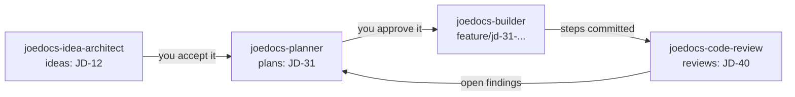

# Agent skills for JoeDocs

Ready-made [Claude Code skills](https://docs.claude.com/en/docs/claude-code/skills) that use JoeDocs as their document store. Each skill keeps its documents in JoeDocs instead of the repository, so they:

- stay out of the code and its pull requests;
- are shared by agents on every machine connected to the server;
- get stable IDs, full history and search for free.

| Skill | What it does | Writes |
| --- | --- | --- |
| [`joedocs-idea-architect`](joedocs-idea-architect/SKILL.md) | Pressure-tests a raw idea or feature brief: frames the problem, separates facts from assumptions, researches material claims, compares options, and proposes the smallest useful experiment. Revises the idea on feedback, and records your decision to accept, park or reject it. | `ideas` |
| [`joedocs-planner`](joedocs-planner/SKILL.md) | Turns an accepted idea, an open review or a request into a traceable, step-by-step delivery plan for a builder. Lists ideas and reviews that have no plan yet, revises drafts, and records approval. | `plans` |
| [`joedocs-builder`](joedocs-builder/SKILL.md) | Executes one approved plan on its own feature branch: one verified, committed step at a time, pausing for your review after each (or straight through if you say so), with evidence in the plan's work log. | the plan's work log; commits in the repository |
| [`joedocs-code-review`](joedocs-code-review/SKILL.md) | Reviews a pull request, branch, commit or the working tree, against the plan when there is one, and records evidence-backed findings with calibrated severities and a verdict. Re-reviews link to the earlier review. | `reviews` |

None of the skills except the builder changes the repository, and the builder never pushes, merges or tags.

## How they fit together



A typical run in Claude Code:

1. `/joedocs-idea-architect Rate limiting for the public API` publishes idea `JD-12` as a draft. Answer its questions; it revises. When you are happy, say *"accept JD-12"*.
2. `/joedocs-planner plan JD-12` publishes plan `JD-31` as a draft. Read it (in Obsidian, or ask for it), ask for changes, then say *"approve JD-31"*.
3. `/joedocs-builder build JD-31` creates `feature/jd-31-rate-limiting-for-the-public-api`, implements `STEP-01`, stages it and stops. Inspect it with `git diff --cached`, then say *"continue"* to commit it and start the next step, or *"run all remaining steps"*.
4. `/joedocs-code-review` on the branch publishes review `JD-40` against the plan's acceptance criteria. Fix what it finds (or plan the fixes with the planner), then ask for a re-review.

Each step is a separate request, and each skill hands off with the next action rather than calling the next skill itself.

## Install

1. Connect Claude Code to your JoeDocs server under the name `joedocs` (see the [deployment guide](../deployment.md#6-connect-clients)). The skills call the tools as `mcp__joedocs__*`. If you used another name, change the `allowed-tools` lists to match.
2. Copy the skill folders into your skills directory, for every project on the machine:

   ```bash
   mkdir -p ~/.claude/skills
   cp -r docs/skills/joedocs-* ~/.claude/skills/
   ```

   Or copy them into `.claude/skills/` in one repository to share them with everyone working on it.

3. Tell the skills which JoeDocs project belongs to the repository, with a line in its `AGENTS.md` or `CLAUDE.md`:

   ```markdown
   JoeDocs project: my-app
   ```

   Without it, the skills match the repository's name against `list_projects` and ask when that is not clear.

4. Start Claude Code in the repository and run `/joedocs-planner <what to plan>` (and so on), or just ask; Claude loads a skill when a request matches its description.

`allowed-tools` in each `SKILL.md` lists the tools the skill may use without asking. The builder's list includes `git add --`, `git commit` and `git switch -c`, so its step commits do not prompt; the project's test and build commands still follow your normal permission settings. Trim the lists if you prefer to be asked.

The skills work with any agent that can read Markdown instructions and call MCP tools. For other agents, copy the body of `SKILL.md` into that agent's instructions and grant it the same tools.

## Document conventions

The skills share these conventions, so their documents work together:

| Type | Written by | Status |
| --- | --- | --- |
| `ideas` | `joedocs-idea-architect` | `draft` → `review` (revised) → `approved` (accepted), or `rejected`. Parked ideas are `parked` if you add that status to `documents.statuses`, otherwise `rejected` with `decision: parked`. |
| `plans` | `joedocs-planner`, and the builder in the work log | `draft` → `approved` → `done` (set by you after review), or `superseded` or `rejected`. Progress is in `implementation_status`: `not-started`, `in-progress`, `blocked`, `completed`. |
| `reviews` | `joedocs-code-review` | `review` while findings are open, `done` with none, `superseded` after a re-review. |

- **IDs and citations.** The JoeDocs ID is the document's ID: an idea `JD-12`, a plan `JD-31`, a review `JD-40`. Items inside a document are numbered locally (`REQ-01`, `STEP-02`, `AC-03`, `MAJ-01`, `R2-MED-01`) and cited from outside with the document ID, as `JD-31 STEP-02`. A specific revision is cited as `JD-12 r3`. Documents also link each other with Obsidian wiki links to their titles.
- **Revisions are the history.** An idea's revisions are the revisions of one document. A plan's approval is the revision with summary `Approve delivery plan`; the builder proves the plan has not changed since with `diff_document`. Every write passes `expected_revision`, so two agents never overwrite each other.
- **Front matter is searchable.** Plans list their sources in `source_ideas` and `source_reviews`, reviews record `verdict`, `actionable_issues` and `related_plan`, and plans record `execution_branch`. For example, `search_documents` with `{"source_ideas": {"contains": "JD-12"}}` finds the plans for an idea, and `{"status": "review", "actionable_issues": {"gt": 0}}` finds open reviews.
- **No empty revisions.** `edit_document`, `update_document` and `change_document_front_matter` refuse a call that would change nothing, with `invalid_argument` (fields `edits`, `content`, `front_matter`). Send only values that differ from what you last read; if a repeated call is refused this way, the document already says what you meant to write, so treat it as done and do not retry with a dummy change.
- **No `null`, no nesting.** JoeDocs rejects `null` and nested objects in front matter, so counts are flat keys (`risks_major`, `issues_medium`) and a key that does not apply is left out.

The types and statuses are the JoeDocs defaults (`documents.types` and `documents.statuses` in [configuration.md](../configuration.md)). If you change them, keep these or adjust the skills.

## More skills to add

| Skill | Purpose | JoeDocs features it uses |
| --- | --- | --- |
| **joedocs-issue-log** | Records bugs and incidents, then appends investigation notes and status changes as work happens. | `append_to_document`, `change_document_front_matter` for `status` and `tags`. |
| **joedocs-research** | Saves research notes with their sources, and searches existing notes before researching again. | `search_documents` across projects (`project: "*"`), `new_document` of type `research`. |
| **joedocs-decision-record** | Writes architecture decision records and marks old ones superseded. | `new_document` of type `specs`, `status: superseded` with a `superseded_by` key. |
| **joedocs-session-journal** | Appends a short summary of each coding session (what changed, what is next) to one running document per project. | `append_to_document`, `get_document_history`. |
| **joedocs-gardener** | Finds stale drafts, documents without tags, and plans whose builder stopped, and suggests tidying. | `list_documents` with `sort`, `search_documents` filters such as `{"implementation_status": "blocked"}` or `{"updated": {"lt": "2026-10-01"}}`. |
